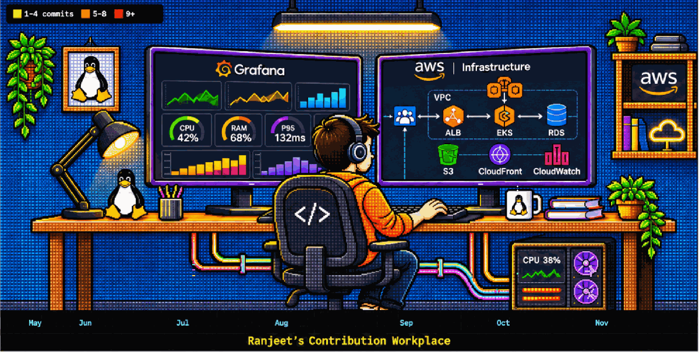

# 🖥️ Ranjeet's Contribution Workplace

An interactive, retro-cyberpunk developer dashboard and live telemetry workstation built with **HTML5, CSS3, JavaScript, Canvas API, and Web Audio API**, connected directly to real GitHub data and AWS infrastructure blueprints.



---

## ⚡ Live Demo

🌐 **Live GitHub Pages URL:**  
[https://ranjeetkumarguptabro-maker.github.io/ranjeet-contribution-workplace/](https://ranjeetkumarguptabro-maker.github.io/ranjeet-contribution-workplace/)

---

## 🌟 Key Features

- **Pixel-Art Developer Workstation:** True to the original reference artwork with dual monitors, ergonomic chair, wood grain desk, under-desk custom PC rig with liquid-cooled conduits, and Linux Tux companion.
- **Left Monitor (Live Grafana & GitHub Telemetry):**
  - Live animated green mountain telemetry wave, yellow network wave, and cyan request bars.
  - Interactive radial dials: **CPU (42%)**, **RAM (68%)**, and **P95 Latency (132ms)** with dynamic jitter simulation.
  - Interactive tabs: `GRAFANA`, `GITHUB`, `LANGUAGES`, and `ACTIVITY` streaming live public repositories, stars, and commit feeds.
- **Right Monitor (Interactive AWS Infrastructure Blueprint):**
  - Architecture map within a VPC: **Users &rarr; ALB &rarr; EKS &rarr; RDS**, plus **S3, CloudFront CDN, and CloudWatch**.
  - Animated glowing data packet flows traversing the network paths.
  - Clickable nodes opening a real-time HUD inspection drawer with architectural roles and metrics.
- **PC Tower Rig with Cooling Fans:**
  - Dynamic `CPU 38%` display with scrolling green ECG telemetry wave.
  - Dual glowing purple RGB cooling fans with interactive click for **TURBO mode** (4,200 RPM)!
- **Bottom Contribution Heatmap Timeline:**
  - 52-week daily contribution grid powered live by `ranjeetkumarguptabro-maker` GitHub API.
  - Authentic retro palette: `1-4 commits` (yellow), `5-8` (orange), `9+` (crimson red).
  - Hover tooltips showing exact date and contribution count.
- **Built-in 8-bit Web Audio Synthesizer:**
  - Pure JavaScript synthesizer (no external audio files required).
  - Retro clicks, chime accords, coffee sip blips, and fan whooshes with sound mute toggle.
- **Room Lighting & Interactive Hotspots:**
  - Studio Warm Light, Late Night Coding, and Cyberpunk Neon modes.
  - Interactive Tux mug with steam bursts, Tux portrait with Linux quotes, and desk lamp toggle.
- **DevOps Ecosystem & Project Showcase:**
  - Skill badges for Git, Docker, Kubernetes, AWS, Terraform, Python, Linux, Grafana, Prometheus, CI/CD, and NGINX.
  - Live repository showcase for `cloudcost-pilot`, `dataops-guardian`, `BlindAI`, etc.
  - Live terminal telemetry console logging all API events in real time.

---

## 🚀 2-Minute Deployment Guide to GitHub Pages

1. **Create Repository:**
   - Create a new public repository on GitHub named:
     `ranjeet-contribution-workplace`

2. **Upload / Push Project Files:**
   - Push all project files to the root of the repository:
     ```bash
     git init
     git add .
     git commit -m "feat: launch interactive contribution workplace dashboard"
     git branch -M main
     git remote add origin https://github.com/ranjeetkumarguptabro-maker/ranjeet-contribution-workplace.git
     git push -u origin main
     ```

3. **Enable GitHub Pages:**
   - Go to repository **Settings** &rarr; **Pages**.
   - Under **Build and deployment**, select **Deploy from a branch**.
   - Branch: `main` / Folder: `/(root)`.
   - Click **Save**.

4. **Your Live Dashboard URL:**
   - `https://ranjeetkumarguptabro-maker.github.io/ranjeet-contribution-workplace/`

---

## 📋 Adding to your GitHub Profile README

To display your animated workplace graphic on your GitHub Profile, copy the contents of [`PROFILE_README.md`](./PROFILE_README.md) into your special profile repository (`ranjeetkumarguptabro-maker/ranjeetkumarguptabro-maker`):

```markdown
<div align="center">

# Ranjeet Kumar Gupta
### Computer Systems Student · DevOps & Cloud Engineering

<p>
  <a href="https://www.linkedin.com/in/ranjeet-kumar-gupta-7b37132a3">
    
  </a>
  <a href="https://github.com/ranjeetkumarguptabro-maker">
    
  </a>
</p>

## 🖥️ Interactive Contribution Workplace

<p>
  <a href="https://ranjeetkumarguptabro-maker.github.io/ranjeet-contribution-workplace/">
    
  </a>
</p>

<!-- Animated Pixel Art Developer Workstation -->
<a href="https://ranjeetkumarguptabro-maker.github.io/ranjeet-contribution-workplace/">
  
</a>

<p align="center">
  <i>👉 <b>Click the workstation</b> above to open the real, live interactive telemetry dashboard!</i>
</p>

</div>
```

---

## 📁 Project Structure

```
ranjeet-contribution-workplace/
├── index.html            # Main dashboard HTML structure & HUD portals
├── style.css             # Cyberpunk retro pixel styling & responsive rules
├── app.js                # GitHub API sync, canvas charts, Web Audio, HUD logic
├── README.md             # Project documentation & GitHub Pages deployment guide
├── PROFILE_README.md     # Ready-to-use profile README for ranjeetkumarguptabro-maker
├── .nojekyll             # Ensures GitHub Pages serves static files directly
└── assets/
    ├── workplace-contribution.gif   # Optimized (500KB) animated pixel-art graphic
    └── workplace-contribution.png   # Ultra-crisp 1696x858 original master graphic
```

---

## 👤 Author

**Ranjeet Kumar Gupta**  
- **University:** Riga Technical University (Computer Systems)  
- **Location:** Riga, Latvia 🇱🇻  
- **GitHub:** [@ranjeetkumarguptabro-maker](https://github.com/ranjeetkumarguptabro-maker)  
- **LinkedIn:** [ranjeet-kumar-gupta-7b37132a3](https://www.linkedin.com/in/ranjeet-kumar-gupta-7b37132a3)  
- **Website:** [codexacode.online](https://codexacode.online)
